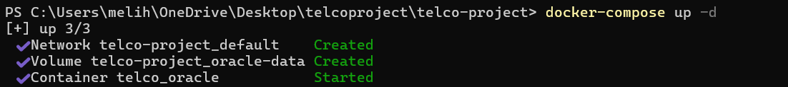
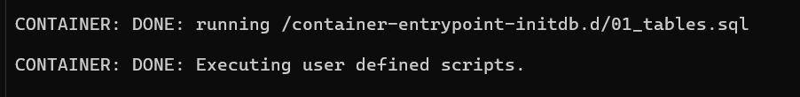
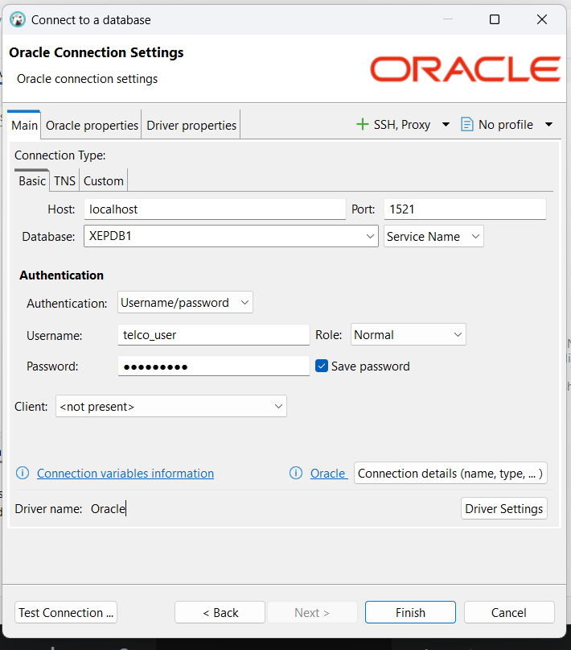
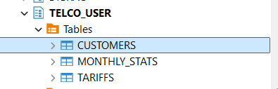

Execution of the docker-compose up -d command, showing the Oracle XE container successfully transitioning to the 'Started' state.

Docker logs verifying the Automated Database Seeding process. The table creation script executes automatically upon container initialization.

DBeaver connection settings configured for the local Oracle XE instance (Host: localhost, Port: 1521, Service: XEPDB1)

Database Navigator in DBeaver confirming that all required tables were successfully created via the automated seeding process.

